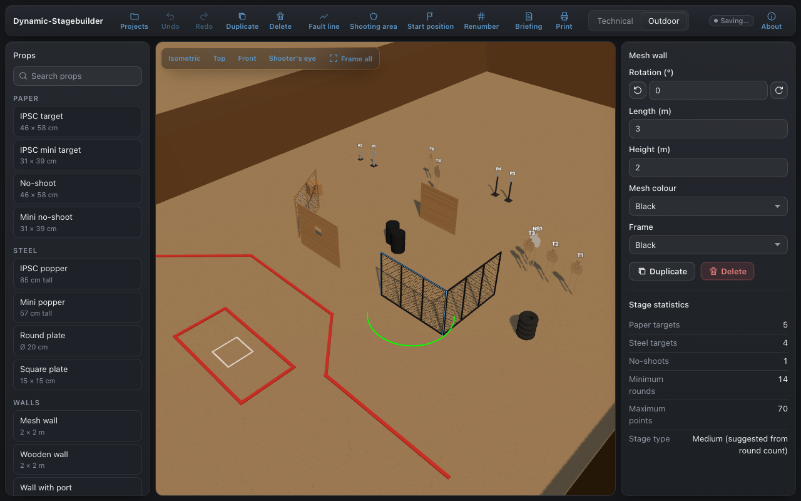
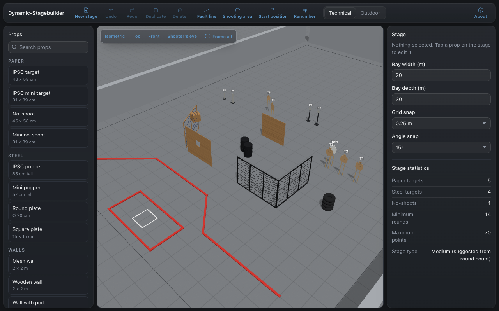
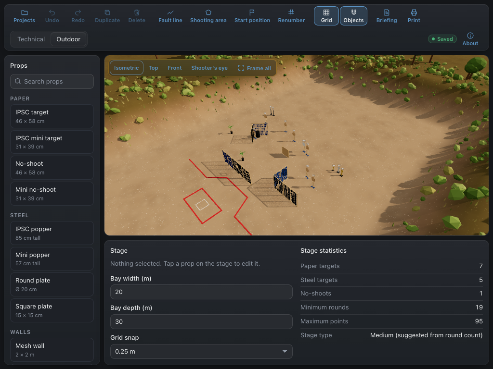
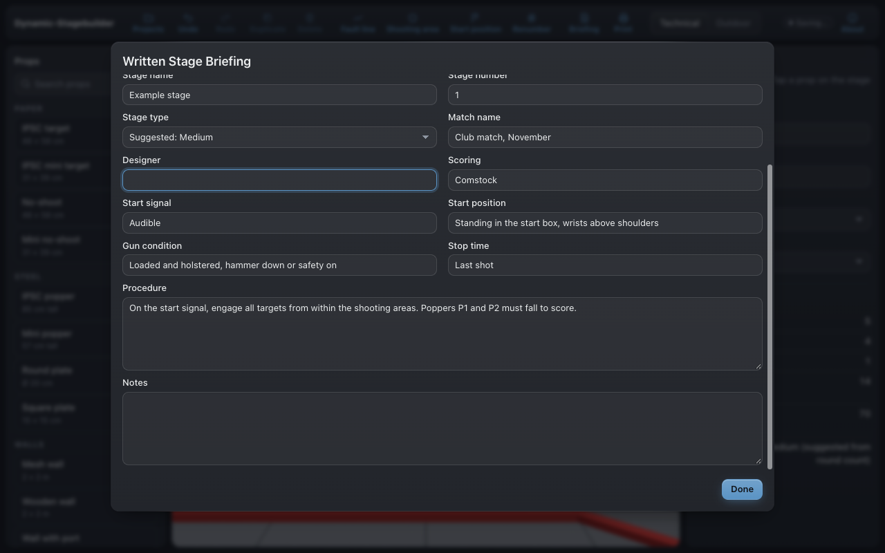
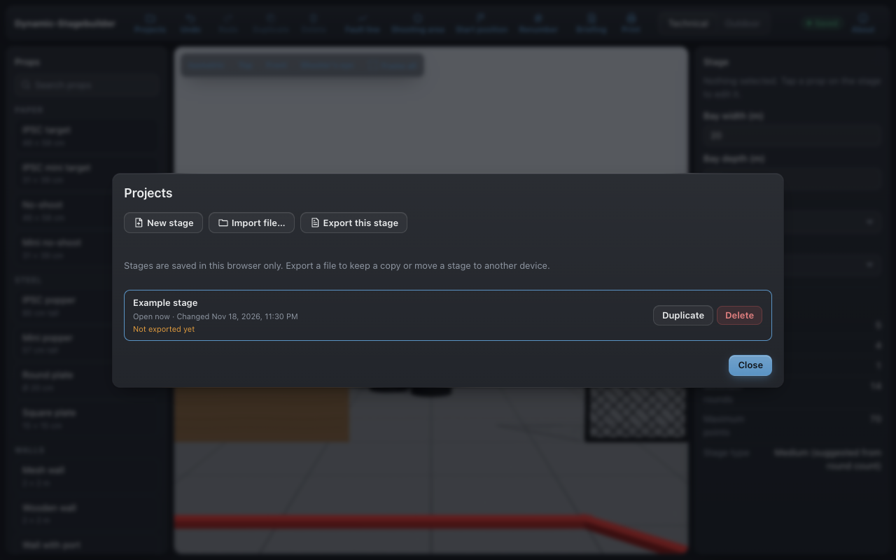

# Dynamic-Stagebuilder

A browser-based 3D stage builder for IPSC practical shooting. Lay out a stage at real scale, look at
it from any angle, and print a Written Stage Briefing with a stage map for range officers and
competitors.

**Version:** 0.1.0 · **Status:** v1 feature-complete, not yet released (see the
[v1 design](docs/superpowers/specs/2026-11-18-stage-builder-v1-design.md)). Started 2026-11-18.

## Who it's for

Professional stage builders and enthusiast IPSC shooters who design stages for club matches and
training, and want a clear briefing sheet without drawing the map by hand.

## What it does

- **Shooting bay** at real scale: width × depth in metres (default 20 × 30 m), 1 m grid.
- **Prop library**, every prop drawn in 3D at real dimensions:
  - stage markings (first in the panel): fault lines, shooting areas, the start position and
    numbered shooting positions with a facing, look angle and stance
  - paper: IPSC target and mini target, each in two versions, Classic (octagon, 45 × 57 cm) or
    With head (46 × 76 cm), on sticks with an adjustable stand height. Each one can be a target, a
    no-shoot or a common competition array (no-shoots over a side or the lower half, between two
    no-shoots, overlapping targets, two targets with a no-shoot between, stacked), with painted
    hard cover (lower ¼, ⅓ or ½, left or right half, lower diagonal)
  - moving and reactive: swinger, drop turner, clamshell, mover on a track (up to four cards),
    bobber, twister, Texas star (5 or 10 plates), plate rack, dueling tree (the last three are
    marked as not allowed in IPSC)
  - activators: step pads and pull levers; start X marks
  - a door that opens, a wall with a shuttered port, hard-cover panels, raised barricades, a wobble
    platform, a balance rope and a step box
  - steel: IPSC popper, mini popper, round plate, square plate
  - walls: mesh wall and mesh wall with port (orange safety netting, or black or blue wire mesh,
    in a light pine or black frame on feet),
    wooden wall, wooden wall with port; ports are real openings
  - mesh doorway (a wall with a door opening) and solid panel (a grey sheet in a pine frame);
    both snap like the other walls
  - structures: ramp, platform
  - obstacles and range furniture: 200 l steel drum (black, blue, red, green), tyre, tyre stack,
    shipping crate, potted plant, car (saloon, hatchback, pickup or van, in five colours), table,
    chair, pallets, sandbag wall, traffic cone
- **Editing by eye:** tap or drag props in, drag them on the ground, rotate them, all with grid and
  angle snapping; multi-select, duplicate, delete, undo and redo.
- **Snapping:** walls snap end to end onto nearby walls, so a run of walls joins up cleanly; other
  props snap to the grid. Hold **Shift** while dragging for slow, fine moves without snapping.
- **Automatic target numbers** (T1…, P1… for steel, NS1… for no-shoots), with hand-set labels kept.
- **Live statistics:** targets, no-shoots, minimum rounds, maximum points, suggested stage type.
- **Written Stage Briefing** editor: match, stage name and number, designer, stage type, scoring,
  start signal, start position, gun condition, procedure, stop time and notes, with common choices
  or your own text. Targets, rounds and points are counted from the stage.
- **Printable brief** (A4): a header with the stage number and key figures, the briefing grid, the
  procedure and a top-down map with a legend and scale bar on page 1, a 3D view on page 2. Save it
  as a PDF from the print dialog.
- **Help** guide with a drawing for every main task, and side panels you can dock left, right or
  under the view, fold away and resize (remembered).
- **Your own surroundings** from a blueprint or site plan, measured with one known length, plus
  building pieces (walls, pillars, columns, berms, containers, fences, barriers), saved as templates.
- **Activation links** from poppers, plates, step pads and pull levers to the moving targets they
  start, listed in the briefing.
- **Animated moving targets** (swingers, drop turners, clamshells, movers, Texas stars, plate racks,
  dueling trees, poppers) with a per-prop switch and one Play / Pause button.
- **Three surroundings,** Outdoor (a dirt range with earth banks, bushes and trees, stones, and a
  choice of sand, light sand, dark sand, red dirt or gravel), Technical (grey floor, grid) and
  Blueprint (an endless, worn blue drafting sheet with grid, title block, comments, arrows and stamps). Switching never moves
  anything on the stage.
- **Environment settings:** time of day (the sun moves and warms toward evening), sunlight,
  ambient light, shadows and their softness, haze, exposure and drifting clouds (amount, speed,
  wind), saved with the stage.
- **The shooter's run:** numbered shooting positions with a stance (standing, crouching,
  kneeling, sitting, prone), facing and look angle, each shown as a detailed see-through grey man
  holding a pistol; the shooter at the start is posed as the briefing's start position says
  (hands up, arms hanging, seated…), pistol holstered. A route on the ground links them; Shooter's
  eye walks it at a chosen speed, looking the way the shooter moves, or jumps between positions.
- **Cameras:** orbit, pan, zoom, Top, Isometric, Front and Shooter's eye; the view is remembered
  per project, so a reload opens where you left off. Figures fade out as the camera comes close.
- **Projects** saved in the browser automatically, with JSON export and import, and a **stage
  library** of 58 ready-made drills and IPSC/USPSA stages (including 24 after the 2012 US IPSC
  Nationals) to open and edit, each with suggested shooting positions worked out from its sight lines.
- **Works offline** and can be installed as an app (PWA).

Not in v1 (ideas for later): matches with several stages, a build sheet with coordinates, measuring
tools, more surroundings and props, model import, version history.

## Devices

Computers (mouse and keyboard first) and iPads (touch; every action also has a button). Phones are
not supported: below 768 px wide the app asks you to use a larger screen. English only.

## What's new

### Unreleased

- **The shooter's run:** shooting positions drawn as a detailed see-through grey man with a
  pistol; a posed shooter in the start box (from the briefing's start position, pistol
  holstered); every library stage comes with suggested positions and the route between them.
- **Shooter's eye:** walks the route faster and more smoothly, looking the way the shooter moves;
  grey arrows in the lower left move the position you stand on; looking around saves the view, at
  the start too; with a position selected it opens there; figures fade out up close; a walking
  speed setting (slow walk to sprint).
- The camera view is remembered per project across reloads.

- Prop groups in the library fold open and closed (remembered; a search opens matching groups).
- The look of a real club range: chunky pine frames, bold black and royal-blue mesh, a new
  solid panel wall, targets with printed scoring zones, chunky yellow and white poppers, heavy
  red fault-line timber, dense potted palms, steep dirt banks with shrubs and crisper light.

- Environment settings (toolbar *Settings*): surroundings, time of day, sunlight, ambient light,
  shadows, shadow softness, haze and exposure.
- New props: ramp, platform, car, table, chair, pallets, sandbag wall, traffic cone and a mesh
  doorway; barrels come in four colours.
- More detail: worn steel drums, treaded tyres, board crates, detailed palms and trees, a gravel
  ground with stones; IPSC targets in the rulebook proportions, standing lower on shorter sticks.

- Walls snap end to end to nearby walls; Grid and Objects snapping toggles in the toolbar.
- Hold Shift while dragging for slow, fine moves.
- New Mesh wall with port and Potted plant; poppers and plates can be white or yellow.
- A new outdoor look after a real dirt range: pine-framed square wire mesh, cardboard targets on
  blue steel stands, earth banks with grass and trees, warm low sun and soft shadows.
- The 3D stage editor: shooting bay, prop library (paper, steel, walls with real ports, obstacles),
  fault lines, shooting areas and the start position; drag, rotate, duplicate, delete, undo/redo.
- Automatic target numbers (T1, P1, NS1) and live round count, points and suggested stage type.
- Technical and Outdoor surroundings, camera presets including the shooter's eye.
- Written Stage Briefing editor and a two-page A4 brief with a top-down map (Save as PDF).
- Projects saved in the browser with autosave, JSON export and import; works offline as an app.

### 0.1.0

- Project created; v1 design agreed. Older versions are listed in [CHANGELOG.md](CHANGELOG.md).

## Screenshots

<table>
  <tr>
    <td><br>The editor: prop library, the stage on an outdoor dirt range at golden hour, stage statistics</td>
    <td><br>Close up: walls joined end to end, a mesh wall with port, targets on stands, lattice shadows</td>
  </tr>
  <tr>
    <td><br>The same stage in the Technical surroundings, with a wall selected and its rotate ring</td>
    <td><br>On an iPad (1024 px): the inspector moves under the 3D view</td>
  </tr>
  <tr>
    <td><br>Shooter's eye: the view from the start position at 1.6 m</td>
    <td><br>The Written Stage Briefing; rounds and points are counted from the stage</td>
  </tr>
  <tr>
    <td><br>Printed brief, page 1: header, top-down map with scale bar, briefing</td>
    <td><br>Printed brief, page 2: the 3D view</td>
  </tr>
  <tr>
    <td><br>Projects saved in this browser, with export hints</td>
    <td><br>Environment settings: surroundings, time of day, light, shadows, haze</td>
  </tr>
  <tr>
    <td><br>The same stage at 19:30: a low, warm sun and long shadows</td>
    <td></td>
  </tr>
</table>

## Installation

No build step and no server-side code. Serve the folder and open it in a browser:

```sh
python3 -m http.server 8002      # then open http://localhost:8002/ (or: claude-update)
```

Any static web server works (the app only loads its own files). Offline support and installing
need `http://localhost` or HTTPS; opened as a `file://` page the editor works but nothing is cached.

**Install as an app:** in Safari on an iPad or Mac, Share → Add to Home Screen (or Add to Dock); in
Chrome or Edge, the install button in the address bar. Installed, it works without a connection, and
Safari keeps its saved stages (a site that isn't installed can lose them after 7 days unvisited).

## Configuration

Stage settings are in the inspector when nothing is selected. They are saved with the stage.

| Setting | What it does | Default |
|---|---|---|
| Bay width | Width of the shooting bay across the range, 1–200 m | 20 m |
| Bay depth | Depth of the bay down range, 1–200 m | 30 m |
| Grid snap | Positions snap to this grid: off, 0.1, 0.25, 0.5 or 1 m (toolbar *Grid* turns it on/off) | 0.25 m |
| Object snap | Toolbar *Objects*: a wall's end jumps onto another wall's end within 35 cm | On |
| Angle snap | Rotations snap to this step: off, 5°, 15°, 45° or 90° | 15° |
| Surroundings | *Settings*: Outdoor (dirt range), Technical (grey floor, grid) or Blueprint (drafting sheet); never moves the stage | Outdoor |
| Ground | *Settings* (Outdoor): sand, light sand, dark sand, red dirt or gravel | Gravel |
| Foliage | *Settings* (Outdoor): mixed broadleaf, Nordic, desert, savanna, tropical or bare banks | Mixed broadleaf |
| Paper / Floor hue, intensity, brightness | *Settings* (Blueprint, Technical): 0–359°, 0–100 %, 40–160 % | Blueprint's blue paper (216°, 80 %), Technical's grey floor (no colour) |
| Show walls | *Settings* (Technical): the backstop and side walls; the floor runs on to the horizon either way | On |
| Cloud shadows | *Settings* (Outdoor): how dark the clouds' shadows on the ground are, 0–100 % | 50 % |
| Time of day | *Settings*: on/off; on, 06:00–20:00 moves the sun (its height, direction and colour follow it) | Outdoor off (sun set by hand), Technical on at 16:00 |
| Sun height, direction, colour | *Settings*, with Time of day off: 2–90°; 0–359° (0° = behind the shooter, 90° = to the shooter's left); dark orange → yellow → white | Outdoor 36°, 30°, warm white |
| Sunlight | *Settings*: 0–200 % | Outdoor 60 %, Technical 115 % |
| Ambient light | *Settings*: 0–200 % | Outdoor 65 %, Technical 110 % |
| Shadows, Shadow softness | *Settings*: on/off, 0 (sharp) – 8 | On; Outdoor 3, Technical 3 |
| Shadow strength | *Settings*: 0–100 %; lower makes shadows lighter | Outdoor 55 %, Technical 55 % (only the props' shadows) |
| Haze | *Settings*: 0 (clear) – 100 % (Outdoor only) | Outdoor 10 % |
| Exposure | *Settings*: 0.5–1.6 | Outdoor 1.10, Technical 1.00 |
| Clouds | *Settings → Environment* (Outdoor): 0 % (clear) – 100 % | 75 % |
| Cloud speed | *Settings → Environment* (Outdoor): 0 (still) – 300 %; 100 % ≈ 8 m/s; they move only with Play on | 130 % |
| Wind direction | *Settings → Environment* (Outdoor): which way the clouds drift, 0° = toward down range, 90° = toward +x | 70° |
| Hidden props | *Settings → Props*: groups and single props the props panel leaves out (per browser) | None |
| Panel places | Drag a panel's tab (or a lone panel's grip ⋮⋮) onto a side for a frame of its own, or onto another frame to add it as a tab; or click the grip for *Move to…* (per browser) | Props, On stage and Projects as tabs on the left; Inspector and Settings on the right (under the view on a narrow screen) |
| Folded panels | The arrow beside the grip (per browser) | Both open |
| Panel sizes | Drag a dock's inner edge, or arrow keys on it (Shift: bigger steps); double-click resets (per browser) | 260 / 300 px, bottom 260 px |
| My surroundings | *Settings*: your own plan-based surroundings, with plan position, turn and strength | None |
| Default target style | *Settings → Props*: Classic (octagon) or With head, for new paper targets | Classic |
| Shooter's eye walking speed | *Settings → View*: slow walk 1.6, walk 2.4, quick move 3.4 or sprint 4.6 m/s, when Play is on (per browser) | Sprint |
| Figures, position marks, route line | *Settings → View*, each: show or hide, colour (seven swatches or your own), opacity 10–100 % (per browser) | Shown, light grey, 30 % |
| Camera view | Remembered per project as you move the camera (per browser) | The Isometric overview |

Prop settings (inspector, one prop selected): label (targets), rotation, and per prop: stand height
for paper targets (0.1–2 m, default 0.7 m to the lowest card's bottom), presentation (target,
no-shoot or an array; default target), hard cover (default none), target style (Classic or With head), base height for steel, plate size
(15–30 cm), wall length (0.5–4 m) and height (0.5–2.5 m), mesh colour (black/blue), frame
(wood/black), port width, height and bottom edge, door width and height, paint for poppers and
plates (white/yellow), plates on a Texas star (5 or 10) or plate rack (4–8), mover track length
(1.5–6 m), car model (saloon, hatchback, pickup, van) and colour, barrel colour, ramp and platform length, width and height, table
length, pallets in a stack (1–6), sandbag wall length and rows, tyres in a stack (1–6), crate size.

Scoring follows the IPSC Combined Competition Rules, January 2024 edition (Handgun): 2 hits per
paper target and 1 per steel target (Comstock), 5 points per A-zone or steel hit, and Short ≤ 12,
Medium ≤ 24, Long ≤ 32 rounds. The rules also limit hits per shooting position, so the stage type
is a suggestion from the round count.

## How to

**Build a stage.** The props panel on the left is grouped (Stage markings, Paper, Steel, Moving
and reactive, Walls, Structures, Obstacles and range furniture); click a group's heading to fold it
away, or hide groups and props you never use in *Settings → Props*. The arrow at the top of each
side panel folds the whole panel to give the 3D view more room, and the grip beside it (⋮⋮) moves the
panel to the left, the right or under the view (drag it there, or click it and choose). Pick a prop in the library, then tap (or click) the ground to place it.
With a mouse you can also drag a prop from the library onto the stage. Drag a placed prop to move it;
it snaps to the grid and stays inside the bay. Rotate the selected prop with the green ring, the
↺/↻ buttons in the inspector, or Q and E. Shift-click selects several props.

**Join walls.** Drag or drop a wall so its end comes within about 35 cm of another wall's end and
it jumps into place, end to end (in a straight line or at a corner). Turn *Objects* off in the
toolbar to place walls freely, and *Grid* off to stop grid snapping. For fine adjustments, hold
**Shift** while you drag: the prop moves at a fifth of the speed and doesn't snap.

**Set up targets and arrays.** Select an IPSC or mini target and pick a *Presentation*: target,
no-shoot, or a common array (no-shoots over a side or the lower half, between two no-shoots,
overlapping, two targets with a no-shoot between, stacked). *Hard cover* paints part of the first
card black. The inspector warns when the top of the array is above 1.8 m (1.6 m for mini targets),
the IPSC limit. Moving and reactive targets (swinger, drop turner, clamshell, mover, Texas star,
plate rack, dueling tree) are in their own group.

**Draw fault lines and shooting areas.** Choose *Fault line* or *Shooting area* at the top of the props panel, tap
the points on the ground, then double-click, press Enter or tap *Finish*. Escape or *Cancel* stops.
*Start position* then a tap sets where the shooter starts (the shooter's-eye camera stands there).

**Use your own range.** In *Settings → Surroundings*, choose *New from a plan…* and pick an image of
your range's blueprint or site plan. Click both ends of something whose real length you know (a
wall, a bay line) and type that length; the plan is scaled to match and laid on the ground. Use the
sliders to move, turn and fade it until it lines up. Then rebuild what's really there with the
*Buildings and surroundings* props (walls, pillars, columns, berms, containers, fences, barriers) and
press *Save pieces to these surroundings*. The template then shows up under *My surroundings* for
every stage. *Edit the pieces on the stage* brings them back to change. Templates live in this
browser only; a stage opened on another device shows a plain floor until you make the template there.

**Link activators.** Select a moving target (swinger, drop turner, clamshell, mover, bobber,
twister, Texas star or shuttered port) and choose what starts it under *Activated by*: a popper,
plate, step pad or pull lever on the stage. Selecting either one shows an orange dashed line
between them; the briefing and the printed brief list every link.

**Animate moving targets.** Select a swinger, drop turner, clamshell, mover, Texas star, plate rack,
dueling tree or popper and switch on *Animate*. The *Play / Pause* button over the 3D view (it
appears once something is animated) starts and stops all of them together.

**Plan the shooter's run.** Pick *Shooting position* in Stage markings and tap each place the
shooter shoots from; they are numbered 1, 2, 3…. In the inspector set the stance (standing,
crouching, kneeling, sitting, prone), the facing and the look up/down angle; each position shows
a grey man in that stance. The man in the start box takes the pose the briefing's *Start position*
describes and has his pistol holstered unless the gun starts on a table or in a case; "facing up
range" turns him round. Library stages come with suggested positions: each target is seen from
one of them, from inside the shooting areas, round the walls.

Click *Shooter's eye*: it opens at the selected shooting position, else at the start. The arrows
under the view buttons (or [ and ]) step from the start to each position, at that stance's eye
height, and *Play run* walks the whole course, pausing at each position. A dashed line on the
ground shows the route between them: click it to add a grab point, drag a grab point to reshape
the route, click one to remove it. With *Play* on, the camera walks the route over the ground,
ramps and platforms, looking the way the shooter moves and turning to the position's view as it
arrives (set the speed in *Settings*); with *Pause* on, it jumps. Standing at the start or a
position, look around and let go: that view is saved. The grey arrows in the lower left move the
position you stand on 25 cm forward, back, left or right (one undo step each). Figures fade out as
the camera comes close, so you never look out from inside one.

**Organise what's on the stage.** The *On stage* tab in the left panel lists every prop on the
stage. Click a row to select it (its settings show on the right); Shift- or ⌘-click, or switch on
*Select several* on an iPad, to pick more. *Group* (⌘G) puts the selection in a group: double-click
its name to rename it, fold it with its arrow, and hide or lock the whole group with its eye and
lock. Drag rows onto a group, or use *Move to…*; copy, paste and delete from the bar. A locked prop
can't be clicked or dragged in the 3D view (change it from the list or the inspector); a hidden
prop isn't drawn but still counts in the statistics and the brief. Right-click a prop in the view
or the list (long-press on an iPad) for cut, copy, paste, duplicate, delete, lock, hide, group,
rotate 90°, select all of that kind, frame the selection and Shooter's eye from a shooting
position; right-click the ground to paste there.

**Number targets.** Targets are numbered as you place them: T1… for paper, P1… for steel, NS1… for
a lone no-shoot (an array with a target is one T label; its targets and no-shoots all count in the
statistics). Deleting a target leaves a gap until you press *Renumber*. To set a label by hand, type
it in the inspector; Renumber keeps hand-set labels and warns about duplicates.

**Look at the stage.** Drag the empty ground to orbit, right-drag (two fingers on an iPad) to pan,
scroll or pinch to zoom. The buttons over the view jump to Isometric, Top, Front, Shooter's eye or
frame everything. *Isometric* is a high oblique "drone" overview (45° down, slightly turned, a
long 32° lens) that fits the whole bay; *Shooter's eye* and *Front* use a natural 55° lens.

**Change the light and surroundings.** *Settings* opens in the right-hand panel (the 3D view stays
live; *Done* or Escape returns to the inspector). It switches between Outdoor and Technical and sets
the time of day, sunlight, ambient light, shadows (on/off, softness, strength), haze and exposure. Changes show as you drag the
sliders; *Reset light to defaults* goes back to the defaults of the surroundings you're in. Nothing on the stage moves, and
the printed 3D view uses the same light.

**Undo anything** with Undo/Redo or ⌘Z / ⇧⌘Z (Ctrl on Windows).

**Write the briefing.** *Briefing* opens the Written Stage Briefing. Fill in the match, stage
number, designer, start signal, start position, gun condition, procedure and notes. Scoring, start
signal, start position, gun condition and stop time have a list of common wordings; *Custom text…*
lets you type your own. *Add a common sentence…* adds a usual procedure line. Targets,
minimum rounds and maximum points are counted from the stage and can't be typed over. Stage type
is suggested from the round count; pick Short, Medium or Long to set it yourself.

**Print the brief or save it as a PDF.** *Print* makes a two-page A4 brief. Page 1: a header with
the stage number, name, minimum rounds and maximum points, the briefing in a grid, the procedure,
and a top-down map of the stage (down range at the top) with a legend and scale bar. Page 2: a 3D
view. A long
procedure carries on to the next page instead of being cut. In the print dialog choose
*Save as PDF*; on an iPad, tap Share → Print, then pinch out on the preview and Share → Save to Files.

**Projects, export and import.** Every change is saved in this browser automatically (the chip in
the toolbar says *Saved*). *Projects* opens in the left-hand panel and lists your stages: open, duplicate or delete them, start a
*New stage*, *Export this stage* as a `.json` file, or *Import file…* to add a stage from a file.
An import always becomes a new project, so it never overwrites one. Below your projects is the
*Stage library*: 58 ready-made stages (drills and standards, short, medium and long IPSC courses,
USPSA and club stages with moving targets). Search or pick a category, then *Open as new project*
to get your own copy to change. A project with changes that
aren't in an exported file shows a hint, so you know when to export a backup.

### Keyboard shortcuts

| Key | Action |
|---|---|
| ⌘/Ctrl Z, ⇧⌘/Ctrl Z | Undo, redo |
| ⌘/Ctrl D | Duplicate the selection |
| Delete / Backspace | Delete the selection |
| Q / E | Rotate the selection by the angle snap |
| Shift while dragging | Move slowly (1/5 speed), without snapping |
| Enter / Escape | Finish / cancel drawing; Escape also clears the selection |
| F | Frame all |
| 1 2 3 4 | Isometric, Top, Front, Shooter's eye |
| [ / ] | In Shooter's eye: previous / next shooting position |
| ⌘/Ctrl C, X, V | Copy, cut, paste the selection |
| ⌘/Ctrl A | Select everything that isn't hidden or locked |
| ⌘/Ctrl G, ⇧⌘/Ctrl G | Group the selection, ungroup |
| L / H | Lock or unlock, hide or show the selection |
| Right-click (long-press) | The prop menu |

## Tests

```sh
npm test            # node --test: tests/*.test.mjs
npm run lint        # ESLint, including the unsafe-DOM rule
```

## Credits

- Ground texture: [Gravelly Sand](https://polyhaven.com/a/gravelly_sand) by Dario Barresi,
  Poly Haven, CC0 (kept in `vendor/textures/polyhaven/gravelly_sand/`).
- [Three.js](https://threejs.org) (MIT), self-hosted in `vendor/three/`.

## License

MIT. See [LICENSE](LICENSE).
