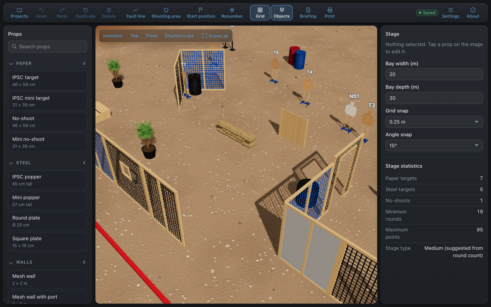
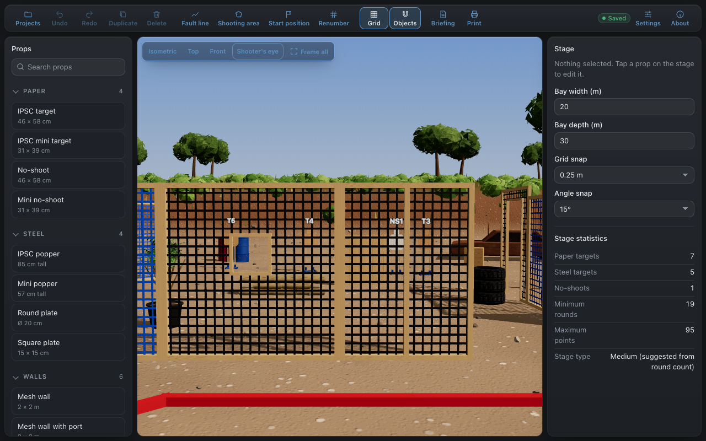
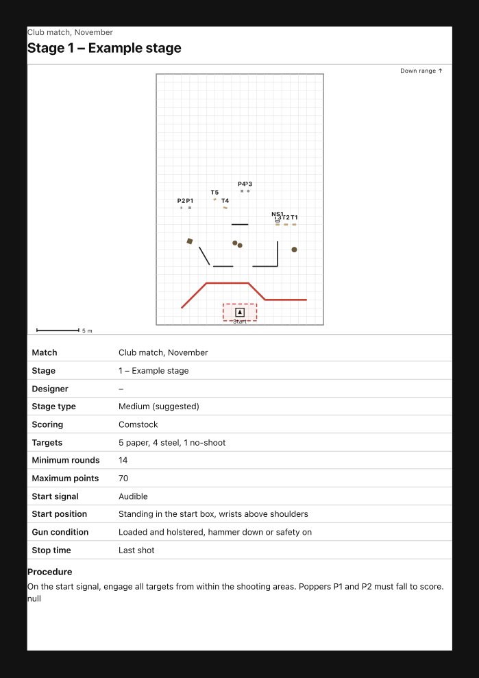
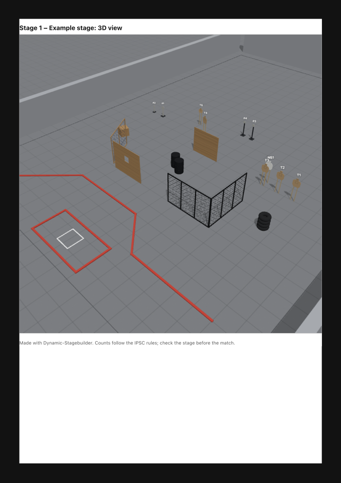
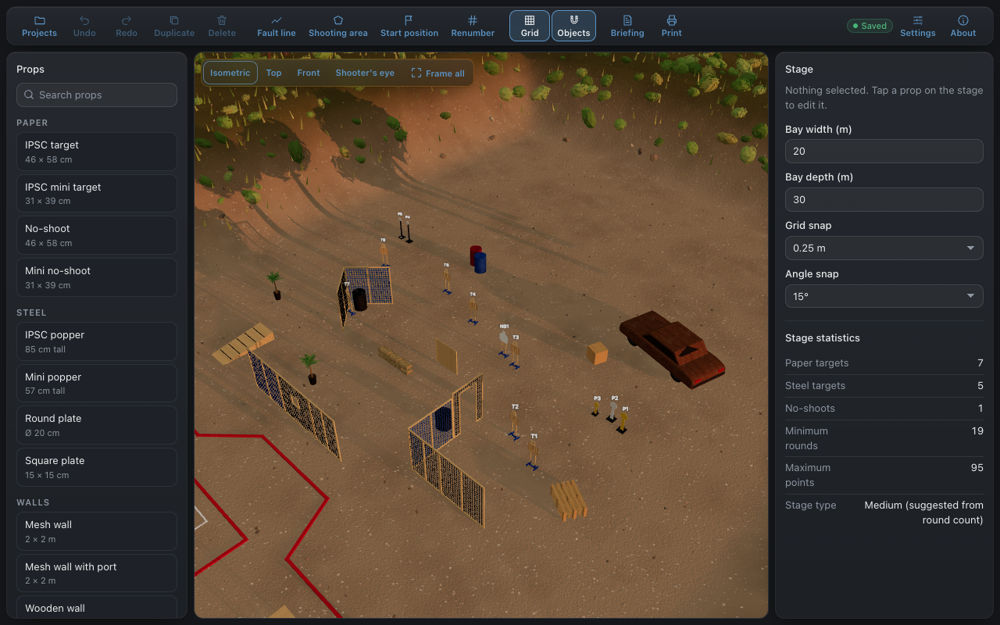

# Dynamic-Stagebuilder

A browser-based 3D stage builder for IPSC practical shooting. Lay out a stage at real scale, look at
it from any angle, and print a Written Stage Briefing with a stage map for range officers and
competitors.

**Version:** 0.1.0 · **Status:** v1 feature-complete, not yet released (see the
[v1 design](docs/superpowers/specs/2026-11-18-stage-builder-v1-design.md)). Started 2026-11-18.

## Who it's for

Professional stage builders and enthusiast IPSC shooters who design stages for club matches and
training, and want a clear briefing sheet without drawing the map by hand.

## What it does

- **Shooting bay** at real scale: width × depth in metres (default 20 × 30 m), 1 m grid.
- **Prop library**, every prop drawn in 3D at real dimensions:
  - paper: IPSC target, mini target, no-shoot, mini no-shoot (on sticks, adjustable height)
  - steel: IPSC popper, mini popper, round plate, square plate
  - walls: mesh wall and mesh wall with port (black or blue 10 cm wire mesh, pine or black frame),
    wooden wall, wooden wall with port; ports are real openings
  - mesh doorway (a wall with a door opening) and solid panel (a grey sheet in a pine frame);
    both snap like the other walls
  - structures: ramp, platform
  - obstacles and range furniture: worn steel barrel (black, blue, red, green), tyre, tyre stack,
    board crate, potted plant, car, table, chair, pallets, sandbag wall, traffic cone
  - fault lines, shooting areas and the start position
- **Editing by eye:** tap or drag props in, drag them on the ground, rotate them, all with grid and
  angle snapping; multi-select, duplicate, delete, undo and redo.
- **Snapping:** walls snap end to end onto nearby walls, so a run of walls joins up cleanly; other
  props snap to the grid. Hold **Shift** while dragging for slow, fine moves without snapping.
- **Automatic target numbers** (T1…, P1… for steel, NS1… for no-shoots), with hand-set labels kept.
- **Live statistics:** targets, no-shoots, minimum rounds, maximum points, suggested stage type.
- **Written Stage Briefing** editor: match, stage name and number, designer, stage type, scoring,
  start signal, start position, gun condition, procedure, stop time and notes. Targets, rounds and
  points are counted from the stage.
- **Printable brief** (A4): briefing and a top-down map with a scale bar on page 1, a 3D view on
  page 2. Save it as a PDF from the print dialog.
- **Two surroundings,** Outdoor (a dirt range with earth banks, bushes and trees, gravel and stones)
  and Technical (grey floor, grid). Switching never moves anything on the stage.
- **Environment settings:** time of day (the sun moves and warms toward evening), sunlight,
  ambient light, shadows and their softness, haze and exposure, saved with the stage.
- **Cameras:** orbit, pan, zoom, Top, Isometric, Front and a shooter's-eye view from the start position.
- **Projects** saved in the browser automatically, with JSON export and import.
- **Works offline** and can be installed as an app (PWA).

Not in v1 (ideas for later): matches with several stages, a build sheet with coordinates, sight-line
analysis, measuring tools, moving targets, more surroundings and props, model import, version history.

## Devices

Computers (mouse and keyboard first) and iPads (touch; every action also has a button). Phones are
not supported: below 768 px wide the app asks you to use a larger screen. English only.

## What's new

### Unreleased

- Prop groups in the library fold open and closed (remembered; a search opens matching groups).
- The look of a real club range: chunky pine frames, bold black and royal-blue mesh, a new
  solid panel wall, targets with printed scoring zones, chunky yellow and white poppers, heavy
  red fault-line timber, dense potted palms, steep dirt banks with shrubs and crisper light.

- Environment settings (toolbar *Settings*): surroundings, time of day, sunlight, ambient light,
  shadows, shadow softness, haze and exposure.
- New props: ramp, platform, car, table, chair, pallets, sandbag wall, traffic cone and a mesh
  doorway; barrels come in four colours.
- More detail: worn steel drums, treaded tyres, board crates, detailed palms and trees, a gravel
  ground with stones; IPSC targets in the rulebook proportions, standing lower on shorter sticks.

- Walls snap end to end to nearby walls; Grid and Objects snapping toggles in the toolbar.
- Hold Shift while dragging for slow, fine moves.
- New Mesh wall with port and Potted plant; poppers and plates can be white or yellow.
- A new outdoor look after a real dirt range: pine-framed square wire mesh, cardboard targets on
  blue steel stands, earth banks with grass and trees, warm low sun and soft shadows.
- The 3D stage editor: shooting bay, prop library (paper, steel, walls with real ports, obstacles),
  fault lines, shooting areas and the start position; drag, rotate, duplicate, delete, undo/redo.
- Automatic target numbers (T1, P1, NS1) and live round count, points and suggested stage type.
- Technical and Outdoor surroundings, camera presets including the shooter's eye.
- Written Stage Briefing editor and a two-page A4 brief with a top-down map (Save as PDF).
- Projects saved in the browser with autosave, JSON export and import; works offline as an app.

### 0.1.0

- Project created; v1 design agreed. Older versions are listed in [CHANGELOG.md](CHANGELOG.md).

## Screenshots

<table>
  <tr>
    <td><br>The editor: prop library, the stage on an outdoor dirt range at golden hour, stage statistics</td>
    <td><br>Close up: walls joined end to end, a mesh wall with port, targets on stands, lattice shadows</td>
  </tr>
  <tr>
    <td><br>The same stage in the Technical surroundings, with a wall selected and its rotate ring</td>
    <td><br>On an iPad (1024 px): the inspector moves under the 3D view</td>
  </tr>
  <tr>
    <td><br>Shooter's eye: the view from the start position at 1.6 m</td>
    <td><br>The Written Stage Briefing; rounds and points are counted from the stage</td>
  </tr>
  <tr>
    <td><br>Printed brief, page 1: header, top-down map with scale bar, briefing</td>
    <td><br>Printed brief, page 2: the 3D view</td>
  </tr>
  <tr>
    <td><br>Projects saved in this browser, with export hints</td>
    <td><br>Environment settings: surroundings, time of day, light, shadows, haze</td>
  </tr>
  <tr>
    <td><br>The same stage at 19:30: a low, warm sun and long shadows</td>
    <td></td>
  </tr>
</table>

## Installation

No build step and no server-side code. Serve the folder and open it in a browser:

```sh
python3 -m http.server 8002      # then open http://localhost:8002/ (or: claude-update)
```

Any static web server works (the app only loads its own files). Offline support and installing
need `http://localhost` or HTTPS; opened as a `file://` page the editor works but nothing is cached.

**Install as an app:** in Safari on an iPad or Mac, Share → Add to Home Screen (or Add to Dock); in
Chrome or Edge, the install button in the address bar. Installed, it works without a connection, and
Safari keeps its saved stages (a site that isn't installed can lose them after 7 days unvisited).

## Configuration

Stage settings are in the inspector when nothing is selected. They are saved with the stage.

| Setting | What it does | Default |
|---|---|---|
| Bay width | Width of the shooting bay across the range, 1–200 m | 20 m |
| Bay depth | Depth of the bay down range, 1–200 m | 30 m |
| Grid snap | Positions snap to this grid: off, 0.1, 0.25, 0.5 or 1 m (toolbar *Grid* turns it on/off) | 0.25 m |
| Object snap | Toolbar *Objects*: a wall's end jumps onto another wall's end within 35 cm | On |
| Angle snap | Rotations snap to this step: off, 5°, 15°, 45° or 90° | 15° |
| Surroundings | *Settings*: Outdoor (dirt range) or Technical (grey floor, grid); never moves the stage | Outdoor |
| Time of day | *Settings*: 06:00–20:00; the sun's height, direction and colour follow it | 16:30 |
| Sunlight, Ambient light | *Settings*: 0–200 % | 100 % |
| Shadows, Shadow softness | *Settings*: on/off, 0 (sharp) – 8 | On, 1.5 |
| Haze | *Settings*: 0 (clear) – 100 % (Outdoor only) | 25 % |
| Exposure | *Settings*: 0.5–1.6 | 0.92 |

Prop settings (inspector, one prop selected): label (targets), rotation, and per prop: mount height
for paper targets (0.1–2 m, default 0.7 m to the target's bottom), base height for steel, plate size
(15–30 cm), wall length (0.5–4 m) and height (0.5–2.5 m), mesh colour (black/blue), frame
(wood/black), port width, height and bottom edge, door width and height, paint for poppers and
plates (white/yellow), barrel and car colour, ramp and platform length, width and height, table
length, pallets in a stack (1–6), sandbag wall length and rows, tyres in a stack (1–6), crate size.

Scoring follows the IPSC Combined Competition Rules, January 2024 edition (Handgun): 2 hits per
paper target and 1 per steel target (Comstock), 5 points per A-zone or steel hit, and Short ≤ 12,
Medium ≤ 24, Long ≤ 32 rounds. The rules also limit hits per shooting position, so the stage type
is a suggestion from the round count.

## How to

**Build a stage.** The library on the left is grouped (Paper, Steel, Walls, Structures, Obstacles
and range furniture); click a group's heading to fold it away. Pick a prop in the library, then tap (or click) the ground to place it.
With a mouse you can also drag a prop from the library onto the stage. Drag a placed prop to move it;
it snaps to the grid and stays inside the bay. Rotate the selected prop with the green ring, the
↺/↻ buttons in the inspector, or Q and E. Shift-click selects several props.

**Join walls.** Drag or drop a wall so its end comes within about 35 cm of another wall's end and
it jumps into place, end to end (in a straight line or at a corner). Turn *Objects* off in the
toolbar to place walls freely, and *Grid* off to stop grid snapping. For fine adjustments, hold
**Shift** while you drag: the prop moves at a fifth of the speed and doesn't snap.

**Draw fault lines and shooting areas.** Choose *Fault line* or *Shooting area* in the toolbar, tap
the points on the ground, then double-click, press Enter or tap *Finish*. Escape or *Cancel* stops.
*Start position* then a tap sets where the shooter starts (the shooter's-eye camera stands there).

**Number targets.** Targets are numbered as you place them: T1… for paper, P1… for steel, NS1… for
no-shoots. Deleting a target leaves a gap until you press *Renumber*. To set a label by hand, type
it in the inspector; Renumber keeps hand-set labels and warns about duplicates.

**Look at the stage.** Drag the empty ground to orbit, right-drag (two fingers on an iPad) to pan,
scroll or pinch to zoom. The buttons over the view jump to Isometric, Top, Front, Shooter's eye or
frame everything.

**Change the light and surroundings.** *Settings* switches between Outdoor and Technical and sets
the time of day, sunlight, ambient light, shadows, haze and exposure. Changes show as you drag the
sliders; *Reset to defaults* goes back to a late-afternoon sun. Nothing on the stage moves, and
the printed 3D view uses the same light.

**Undo anything** with Undo/Redo or ⌘Z / ⇧⌘Z (Ctrl on Windows).

**Write the briefing.** *Briefing* opens the Written Stage Briefing. Fill in the match, stage
number, designer, start signal, start position, gun condition, procedure and notes. Targets,
minimum rounds and maximum points are counted from the stage and can't be typed over. Stage type
is suggested from the round count; pick Short, Medium or Long to set it yourself.

**Print the brief or save it as a PDF.** *Print* makes a two-page A4 brief: the briefing and a
top-down map with a scale bar on page 1 (down range at the top), a 3D view on page 2. A long
procedure carries on to the next page instead of being cut. In the print dialog choose
*Save as PDF*; on an iPad, tap Share → Print, then pinch out on the preview and Share → Save to Files.

**Projects, export and import.** Every change is saved in this browser automatically (the chip in
the toolbar says *Saved*). *Projects* lists your stages: open, duplicate or delete them, start a
*New stage*, *Export this stage* as a `.json` file, or *Import file…* to add a stage from a file.
An import always becomes a new project, so it never overwrites one. A project with changes that
aren't in an exported file shows a hint, so you know when to export a backup.

### Keyboard shortcuts

| Key | Action |
|---|---|
| ⌘/Ctrl Z, ⇧⌘/Ctrl Z | Undo, redo |
| ⌘/Ctrl D | Duplicate the selection |
| Delete / Backspace | Delete the selection |
| Q / E | Rotate the selection by the angle snap |
| Shift while dragging | Move slowly (1/5 speed), without snapping |
| Enter / Escape | Finish / cancel drawing; Escape also clears the selection |
| F | Frame all |
| 1 2 3 4 | Isometric, Top, Front, Shooter's eye |

## Tests

```sh
npm test            # node --test: tests/*.test.mjs
npm run lint        # ESLint, including the unsafe-DOM rule
```

## License

MIT. See [LICENSE](LICENSE).
